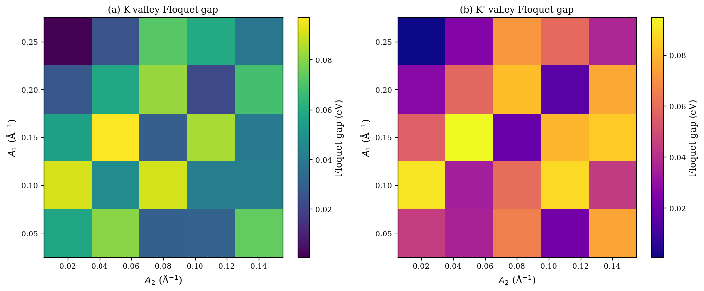

# Floquet Gap Engineering and Valley Selective Transverse Drift Velocity in Graphene: A DFT-Guided Study

This repository contains a DFT-guided computational study of Floquet gap engineering and valley-selective transverse drift in gapped monolayer graphene under a two-frequency counterrotating bicircular laser. DFT calculations provide the Fermi velocity (0.945 × $10^6$ m/s) used to parametrize a low-energy Dirac Hamiltonian, and the time-dependent Schrödinger equation is solved in QuTiP over 500 fs. The Floquet gap is phase-dependent and anti-phase between the K and K′ valleys, oscillating between ~0.019 eV and ~0.030 eV with period π. A maximum valley gap difference of 0.011 eV at φ = 0.25π gives a valley polarization contrast of 0.58 near φ ≈ 0.83π. The resulting cycle-averaged light-induced transverse drift velocity ranges from +0.44 to −6.27 Å/fs and reverses sign near φ ≈ 1.5π, providing an all-electrical signature of valley-selective Floquet physics for phase-controlled valleytronic applications.

###  Heat map of Floquet Gap near K and k' valley

